<div align="center">

# Chestnut Table 51

**A serverless, offline-capable Progressive Web App for running and tracking a recurring poker league,
built on GitHub Pages with git as its database.**

[**Live app**](https://sherurox.github.io/chestnut-table-51/) ·
[Architecture](#architecture) ·
[Engineering highlights](#engineering-highlights) ·
[Run locally](#getting-started)


<br/>

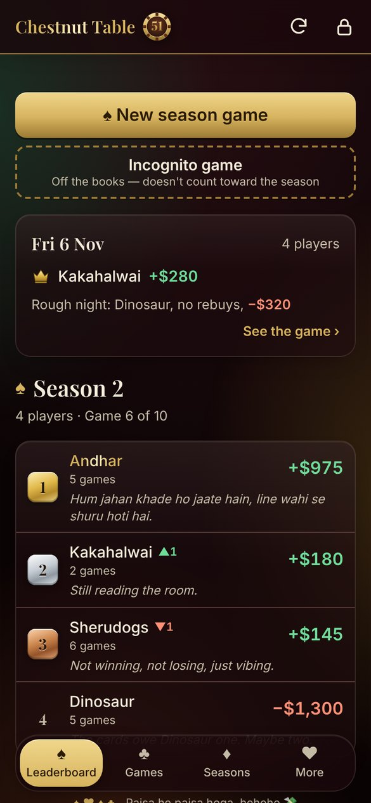
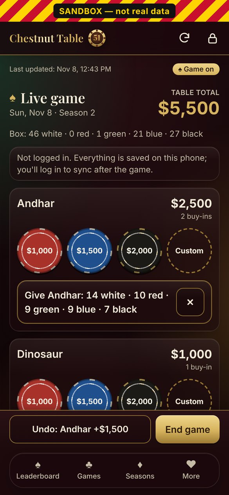
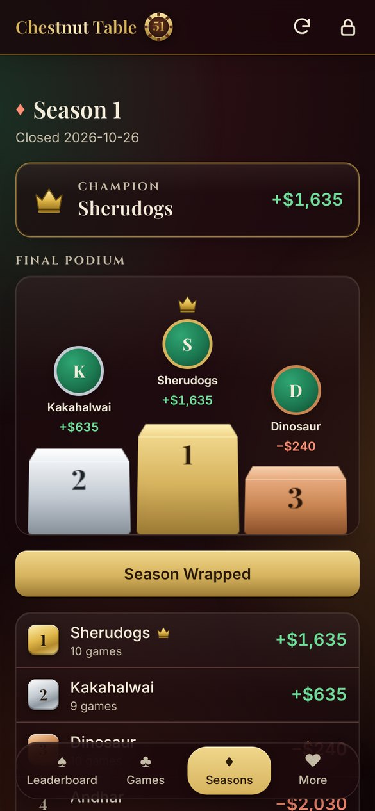
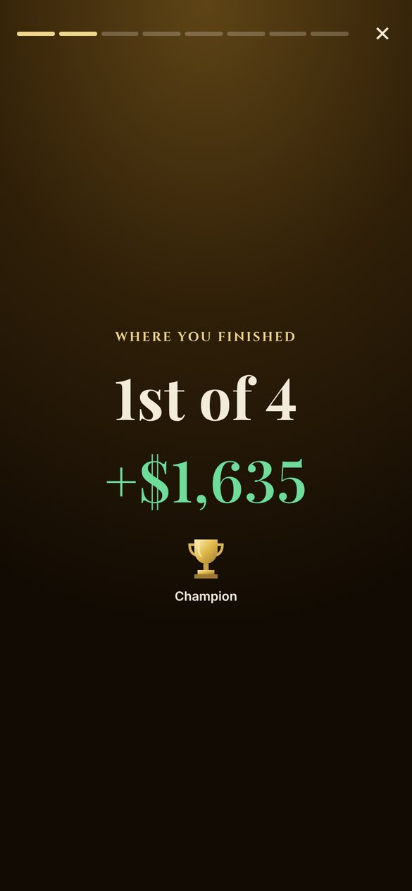

</div>

---

## Overview

Chestnut Table 51 replaces the notebook and group-chat arithmetic of a nightly home poker game with a
purpose-built mobile app. One admin runs each game on their phone: players, buy-ins, final chip counts.
Everyone else follows along read-only: standings, history, statistics and end-of-season recaps.

The constraint that shaped the design was **no infrastructure budget**. The app runs entirely on free
GitHub services:
- **GitHub Pages** serves the static app.
- **A single validated JSON file in this repository** is the database.
- **The GitHub REST API** handles reads and writes.
- **GitHub Actions** runs CI/CD.

Every save is a git commit, which gives the league a complete, auditable change history for free.

The app has been **in daily use by a four-player league since October 2026**, across multiple seasons.

---

## Engineering highlights

| Area | What was built |
|---|---|
| **Serverless persistence** | Reads and writes go through the GitHub contents API. A write fetches the latest file and its `sha`, applies a pure `(data) => data` change, validates it, and commits. A `409` from a concurrent save triggers an automatic refetch-and-reapply, up to 3 times. |
| **Data integrity** | Only raw facts are stored. Every total, ranking, champion and badge is derived at read time. A zod schema enforces referential integrity, uniqueness and a strict chip-conservation check on every write. |
| **Backend-free authentication** | The admin's fine-grained GitHub token is encrypted client-side with **PBKDF2-SHA256 (600,000 iterations) + AES-256-GCM** and committed only as ciphertext. It's decrypted in the browser and held in memory, never in storage, URLs or logs. |
| **Offline-first** | Live games autosave to `localStorage` on every tap. Finished games enter a durable sync queue that survives reloads and pushes when connectivity returns, with duplicate-save and stale-data guards. |
| **Bundle security** | Admin code is a lazy-loaded chunk that viewers never download. A custom post-build verifier fails CI if admin, dev-only or sandbox code, secrets, or API caching leak into the production bundle. |
| **Testing** | **670+ unit tests** across 55 files (~8.5k lines), including a seeded property test that every season's net winnings sum to $0, cross-checks between independent derivations, and DOM snapshot tests. |
| **Deterministic dev sandbox** | A dev-server-only mode with its own data file, a throwaway encrypted key and a middleware that reuses the production write path. It's compiled out of production builds, and the build verifier proves it. |
| **Release safety** | Data commits skip deployment (`paths-ignore`). The service worker update flow reloads viewer screens automatically but never interrupts an admin mid-game. Stale-chunk errors recover with a single guarded reload. |
| **Client-side media** | Shareable results cards (1080×1350) and season-recap story images (1080×1920) are rendered with the Canvas 2D API. Sound effects are synthesised with the Web Audio API. No image or audio assets or libraries. |
| **Accessibility and motion** | WCAG AA contrast in both themes, 48px+ touch targets, semantic markup and screen-reader labels throughout. Every animation is disabled under `prefers-reduced-motion` or an in-app setting, enforced by a test. |

---

## Features

### Running a game (admin)

<table>
<tr>
<td width="33%"></td>
<td width="33%">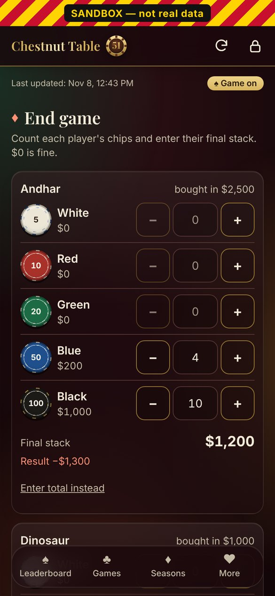</td>
<td width="33%">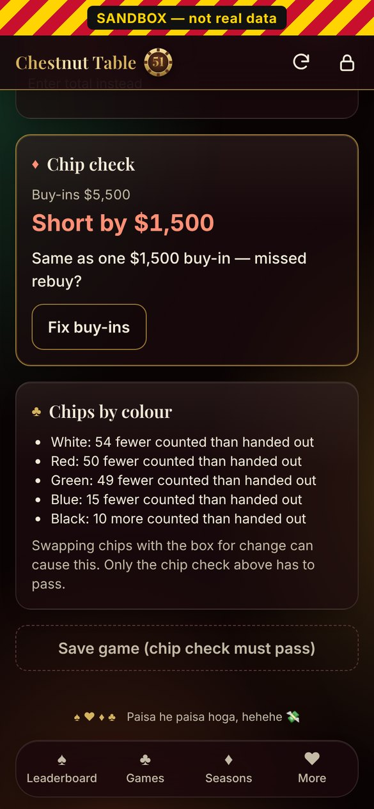</td>
</tr>
<tr>
<td><sub><b>Live game.</b> Preset and custom buy-ins, undo, late arrivals, and per-buy-in chip hand-out suggestions from a tracked chip inventory.</sub></td>
<td><sub><b>Final stacks.</b> Count chips per denomination with steppers, or enter a total.</sub></td>
<td><sub><b>Strict chip check.</b> Saving is blocked until stacks equal buy-ins. Here it spots a likely missed $1,500 rebuy.</sub></td>
</tr>
</table>

- **Game setup:** player search, "same players as last game", season or off-the-books (incognito) mode,
  and an explicit choice for guests (promote them into the season, or keep the game unranked).
- **Strict chip conservation:** every game must balance exactly, with no override. Mismatches show the
  exact gap and flag a gap that equals a buy-in as a likely missed rebuy.
- **Automatic season lifecycle:** seasons are capped at 10 games. Saving the 10th game closes the season
  and crowns the champion in the same atomic commit.
- **Full audit trail:** edit, soft-delete or restore any game in any season. Each change reruns
  validation, warns before altering a closed season's champion, and lands as a descriptive commit
  (`Admin: edited game 2026-10-29 (Season 2)`).
- **Player and season management:** add, rename, archive and promote players; start, end and rename
  seasons.

### Following the league (everyone)

<table>
<tr>
<td width="25%"></td>
<td width="25%">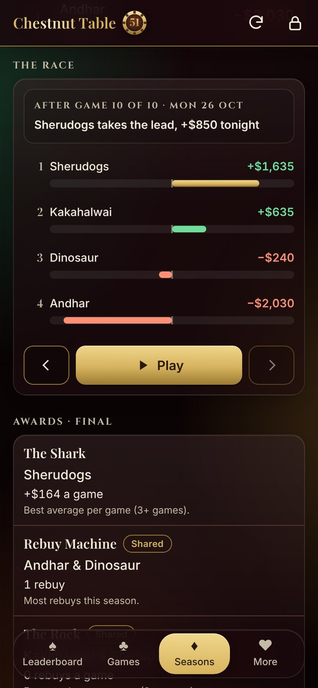</td>
<td width="25%">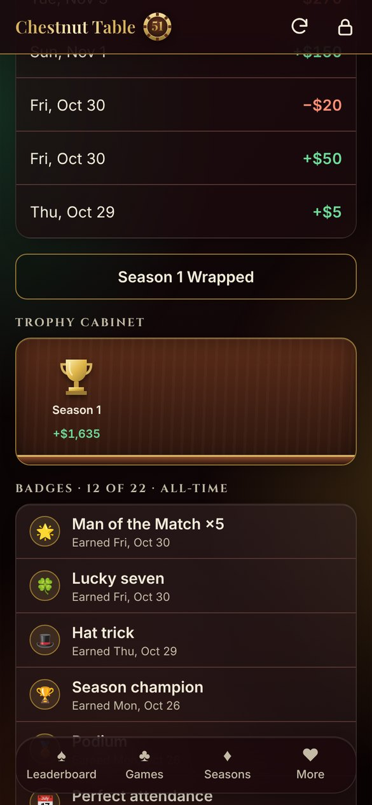</td>
<td width="25%">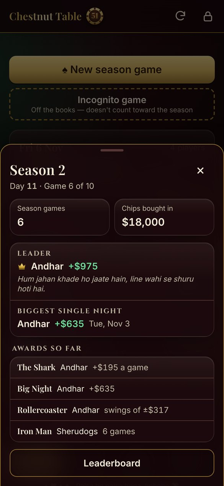</td>
</tr>
<tr>
<td><sub><b>Leaderboard</b> with rank changes, titles and the latest game.</sub></td>
<td><sub><b>Season race</b> replays the standings game by game, with animated reordering.</sub></td>
<td><sub><b>Player page</b> with a trophy cabinet and 22 badges.</sub></td>
<td><sub><b>Season stats</b> sheet, available from every screen.</sub></td>
</tr>
</table>

- **Leaderboard and history:** live standings, game-by-game history, per-game detail with every
  buy-in, and the git-backed edit history.
- **Player analytics:** net-winnings chart, win rate, average per game, best and worst nights, streaks,
  rebuy rate and head-to-head nemesis.
- **Gamification engine:**
  - 6 performance-based titles with situational overrides
  - 22 badges (per-game, milestone and season-close), with repeat counts
  - 7 season awards
  - a Hall of Fame documenting every rule and its current holders
- **Season showcase:** a CSS 3D podium, a trophy cabinet per player, and an animated race replay with
  generated captions ("takes the lead, +$850 tonight").
- **Utilities:** a Texas Hold'em hand-rankings guide with drawn cards, and a chip-distribution
  calculator.

### Season Wrapped and sharing

<table>
<tr>
<td width="25%"></td>
<td width="25%">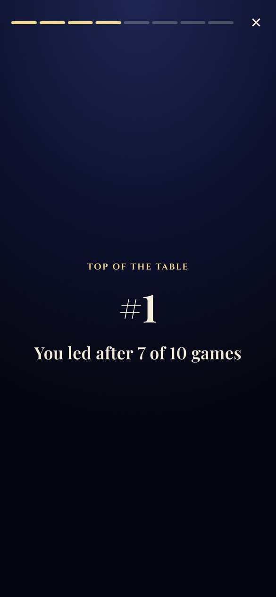</td>
<td width="25%">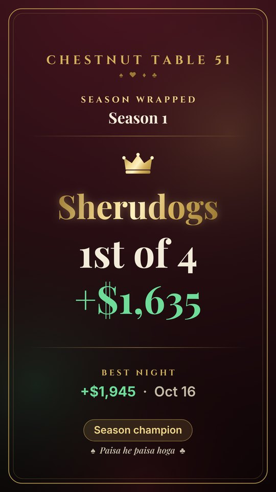</td>
<td width="25%">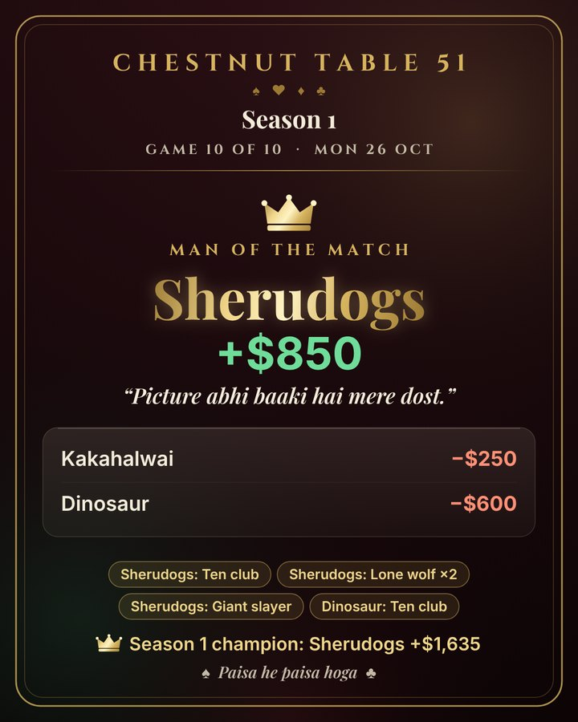</td>
</tr>
<tr>
<td colspan="2"><sub><b>Season Wrapped:</b> a full-screen, tap-through story per player for each closed season: placement, best night, time at #1, toughest night, nemesis, badges and title.</sub></td>
<td><sub><b>Story image</b> (1080×1920), shared through the native share sheet.</sub></td>
<td><sub><b>Results card</b> (1080×1350) for any game, drawn on canvas.</sub></td>
</tr>
</table>

- **Shared through the native Web Share API.** iOS requires the share to happen inside the user's tap,
  so images are pre-rendered before it, and there's a press-and-hold fallback where file sharing isn't
  available.
- **Wrapped is skip-aware:** a slide with nothing true to say is left out, and every figure comes from
  the same tested helpers as the rest of the app.
- **Sound design:** a chip clink, a save sting and a win flourish, all synthesised at runtime with Web
  Audio. Sounds respect the device's silent mode and have their own toggle.

### Design system

<table>
<tr>
<td width="33%">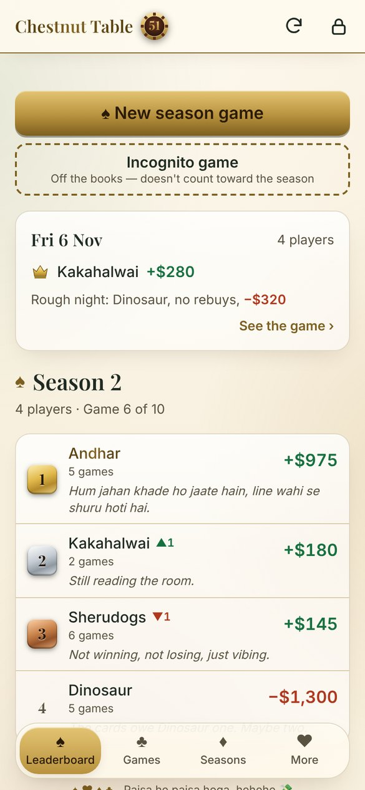</td>
<td width="33%">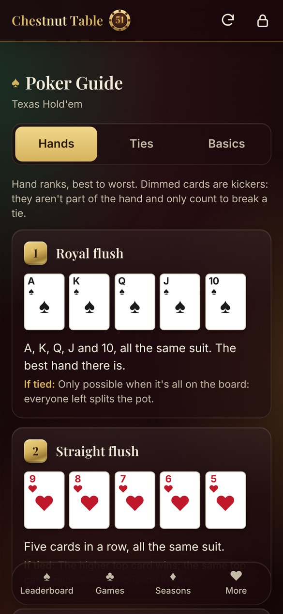</td>
<td width="33%">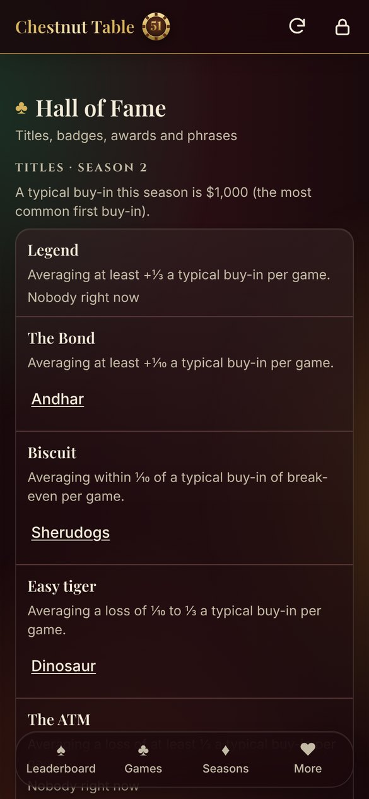</td>
</tr>
</table>

- **A token-based design system** (CSS custom properties) with dark and light themes. Contrast is
  verified against the brightest background element in both.
- **"Liquid glass" chrome:** a backdrop-filtered header and a floating navigation pill with a
  spring-animated indicator. Content panels get a glass look without real blur, to keep scrolling
  smooth, and every glass element has a solid `@supports` fallback.
- **Motion:** spring easing via CSS `linear()`, FLIP list reordering, count-ups and View Transitions.
  The live-game screens are deliberately static, so the admin can tap fast.
- **Self-hosted fonts** (Playfair Display, Inter, Cinzel), precached for offline use.
- **Installable** on iOS and Android, with platform-specific install guidance.

---

## Architecture

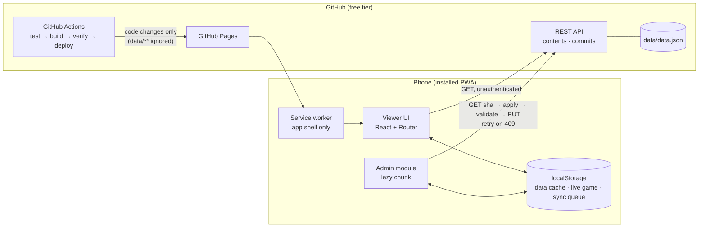

### Write path

```
fetch latest (content + sha)
  → apply change as a pure function (data) => data
  → migrate + zod validation  ──✗──> abort with a readable error
  → PUT with sha + descriptive commit message
       ├─ 200 → update UI from the data just written
       ├─ 409 (concurrent save) → refetch and reapply (≤ 3 attempts)
       └─ network failure → stay in the local sync queue, retry on reconnect
```

### Key design decisions

| Decision | Rationale |
|---|---|
| Git-backed JSON instead of a database | Zero cost and zero ops, with a free version history. The dataset is small and writes are infrequent, so this is a good fit. |
| Store raw facts only, derive everything | Editing any historical game automatically corrects every downstream number. There's no cache invalidation and no drift. |
| All domain logic as pure functions in `src/domain/` | Money logic is unit-testable in isolation. UI code never does arithmetic on balances. |
| Changes expressed as `(data) => data` | Makes optimistic-concurrency retries trivial: reapply the same function to fresh data. |
| Client-side encrypted token, memory-only | Admin write access without a backend. The repo never contains a usable secret. |
| Viewer and admin split by lazy chunk | Viewers download less code and never receive admin code. Enforced by a build check, not by convention. |
| Fetch on open and on refresh only; never poll | Stays well inside the unauthenticated API rate limit and conserves battery. |
| Service worker caches the app shell only, never data | One source of truth for cached data (`localStorage`), so stale API responses are impossible. |

### Data model

```ts
interface Data {
  version: 1;                        // migrations upgrade older files step by step
  settings: { presetBuyIns: number[] };
  players: Player[];                 // regular | guest; active | archived
  seasons: Season[];                 // at most one active
  games: Game[];                     // season | incognito; finished | deleted (soft)
  liveGame: LiveMarker | null;       // signals a game in progress on the admin's device
}
```

Validation rejects any write that breaks one of these rules:
- unique ids, and unique names (case-insensitive)
- every reference resolves
- at most one season is active
- every finished game has 2+ players, one cash-out per player, at least one buy-in each, and exact chip
  conservation
- amounts are integers within bounds
- no unranked guests appear in ranked games

### Security model

- **Viewers:** anonymous and read-only. Unauthenticated reads stay inside GitHub's public rate limit,
  with a cached fallback when it's hit.
- **The admin token:** a fine-grained GitHub PAT scoped to this repository only, with contents
  read/write and nothing else.
- **Encryption:** a one-time CLI encrypts the token with the admin passphrase, using hidden TTY input
  only and a 16+ character passphrase. It writes `public/admin-key.json`: salt, IV and AES-GCM
  ciphertext.
- **Login:** the browser derives the key with Web Crypto and decrypts. A wrong passphrase fails the
  AES-GCM authentication tag. The plaintext token exists only in a module-scoped variable, and reloading
  the page logs out.
- **Defence in depth:**
  - a test scans the source for token-shaped strings
  - the build verifier scans `dist/`
  - error messages are tested to never contain the token
  - the admin is warned 14 days before the token expires

---

## Tech stack

| Layer | Technology |
|---|---|
| UI | React 19, TypeScript (strict), React Router 7 (hash routing for static hosting) |
| Styling | Tailwind CSS 4 with a custom token-based design system |
| Build | Vite 8 |
| Validation | zod |
| Charts | Recharts |
| Graphics and audio | Canvas 2D API, Web Audio API, CSS 3D transforms |
| Platform APIs | Web Crypto, Web Share (Level 2), Service Worker, View Transitions, `localStorage` |
| PWA | vite-plugin-pwa (Workbox) |
| Testing | Vitest: unit, property-based (seeded PRNG) and DOM snapshot tests |
| Data and hosting | GitHub REST API, GitHub Pages |
| CI/CD | GitHub Actions |

There are 8 runtime dependencies in total.

---

## Quality gates

Every commit must pass:

```bash
npm test && npm run build && npm run check:bundle
```

**What the tests cover:**
- **Domain:** results, the chip check and its hints, rankings and tiebreaks, season limits and
  auto-close, guest promotion, edits and deletes in closed seasons, and schema rules (one test per rule)
- **Invariants:**
  - zero-sum season totals over randomized valid games
  - race replay frames equal to the standings at every game
  - trophies in one-to-one agreement with season-close badges
- **Concurrency and offline:** sha-conflict retries, duplicate-save guards, stale-edit detection and
  queue persistence
- **UI contracts:**
  - every animation is covered by the reduced-motion rules
  - the admin screens are pinned by DOM snapshots
  - generated images fit their canvas and contain no emoji (checked with a recording canvas fake)
- **Security:** secret scanning, and token-free error messages

**The bundle verifier (`scripts/check-bundle.mjs`)** inspects the production build. It fails if:
- admin code reaches the viewer entry
- the admin chunk is precached, or its runtime cache rule is missing
- the service worker references GitHub API or data URLs
- any sandbox code, key or endpoint ships
- a credential-shaped string appears anywhere in `dist/`

**The CI pipeline** (`.github/workflows/deploy.yml`):

```
checkout → Node 22 → npm ci → npm test → npm run build → npm run check:bundle → deploy to Pages
```

Commits that only change `data/**` (every game save) skip the pipeline.

---

## Getting started

**Prerequisites:** Node.js 22+.

```bash
git clone https://github.com/sherurox/chestnut-table-51.git
cd chestnut-table-51
npm ci

npm run dev            # HTTPS dev server (Web Crypto needs a secure context on LAN devices)
npm test               # run the test suite
npm run build          # type-check and build to dist/
npm run check:bundle   # verify the production bundle
```

### Sandbox mode

Exercise every admin flow against a local copy of the data, never the real file:

```bash
SANDBOX=1 npx vite --host           # https://<lan-ip>:5174, for testing on a phone
SANDBOX=1 DEV_HTTP=1 npx vite       # http://localhost:5181, for desktop review
```

- **Its own data:** `data/sandbox.json`, seeded from `data/data.json`. Delete it to reseed.
- **A throwaway admin key** that encrypts a dummy token. The localhost server exposes the test
  passphrase for automated testing.
- **The production write path:** writes go through the same change functions, validation and retry
  loop, served by dev middleware.
- **Clearly separated:** a persistent "SANDBOX" banner, isolated ports and isolated browser storage.

### Deploying your own instance

1. Fork the repo. Set `owner` and `repo` in `src/config.ts`, and Vite's `base` to `/<repo>/`.
2. Reset `data/data.json` to the empty starting file:
   ```json
   { "version": 1, "settings": { "presetBuyIns": [1000, 1500, 2000] },
     "players": [], "seasons": [], "games": [], "liveGame": null }
   ```
3. Create a fine-grained PAT scoped to that repository, with *Contents: read and write* only.
4. Run `node scripts/encrypt-token.mjs`, then commit the generated `public/admin-key.json`. Never
   commit the raw token.
5. Enable GitHub Pages with GitHub Actions as the source, then push to `main`.

---

## Project structure

```
src/
├─ domain/       pure, framework-free logic: types, schema, results, standings, live game,
│                edits, season lifecycle, chips, gamification, podium/trophies (unit-tested)
├─ lib/          presentation logic: formatting, share text, race frames, Wrapped model,
│                canvas renderers, sound synthesis, celebrations
├─ storage/      the only network layer: GitHub read/write, auth, key decryption, sync queue
├─ state/        React context and hooks
├─ design/       design tokens, brand components, icons, motion utilities
├─ components/   shared UI: shell, standings, race, podium, trophy cabinet, share flows
├─ screens/      viewer screens (Wrapped is its own lazy chunk)
├─ admin/        admin screens (lazy chunk, never shipped to viewers)
└─ devserver/    dev-only sandbox middleware
scripts/         token encryption CLI, bundle verifier, icon renderer
data/data.json   the database
CLAUDE.md        full engineering specification
```

About 15,000 lines of application TypeScript and about 8,500 lines of tests.

---

## Development process

The project was developed **specification-first**. [`CLAUDE.md`](CLAUDE.md) defines:
- the non-negotiable rules
- the domain and data model
- the security model
- the design system
- a phased delivery plan, each phase with explicit acceptance criteria

Implementation used AI pair programming (Claude Code) under that specification, with human review of
every plan and change.

Delivery ran in six phases:
1. Domain logic and tests
2. The deployed viewer app
3. Authenticated writes
4. Live games and offline sync
5. Admin tooling
6. Polish

These were followed by feature increments, each built on its own branch, verified in the sandbox and on
physical iOS devices, then merged:
- table tools
- the UI redesign
- shareable results
- the season showcase
- Season Wrapped

---

## Roadmap

- [x] Live game tracking with strict chip conservation and offline sync
- [x] Admin tooling with a full audit history
- [x] Gamification: titles, 22 badges, season awards, Hall of Fame
- [x] Design system v2 with liquid-glass UI, motion and sound
- [x] Shareable canvas-rendered results cards
- [x] Season race replay, 3D podium, trophy cabinet
- [x] Season Wrapped stories with shareable images
- [ ] Player trading cards
- [ ] Poker hand quiz
- [ ] Animated chip stacks on the live game screen

---

## Author

**Shreyas Khandale**: [GitHub @sherurox](https://github.com/sherurox)

Screenshots show the production app running on real league data, captured at a 390px phone viewport.
The live-game screens were captured in sandbox mode.
